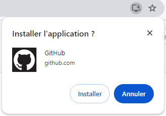
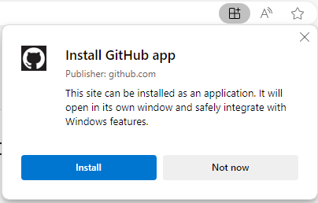
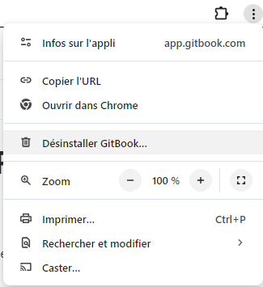
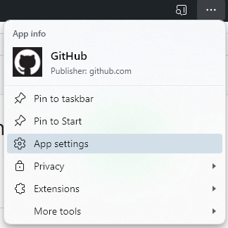

# How to install/remove a PWA?

## Understanding PWA installation

PWA installation is different from traditional app installation:

**What actually happens:**
- Your browser creates a **shortcut** with app metadata
- Resources are **cached** for offline use (not downloaded permanently)
- The app **opens in its own window** (without browser UI)
- No web server runs on your device

**What doesn't happen:**
- No executable files downloaded to your system
- No traditional installation process
- No storage of source code on your device
- No permanent local copy

Think of it as a **smart bookmark** that:
- Opens in a dedicated window
- Works offline through caching
- Integrates with your operating system
- Receives updates automatically

## Installation requirements

For your PWA to be installable, the manifest must include:

- App name (`name` and/or `short_name`)
- At least one icon (192x192px minimum)
- Start URL (`start_url`)
- Display mode (`display`)

See the [Application Information page](the-manifest/application-information/README.md) for complete requirements.

!!! warning

    Installation criteria vary by browser and may change over time. Some browsers require HTTPS, user engagement, or additional manifest properties.

## Installing a PWA

### Chrome (desktop & Android)

When you visit a PWA-enabled website, Chrome displays an install icon in the address bar (right side).

**Steps:**
1. Click the install icon (⊕ or computer monitor icon) in the address bar
2. Review the app information in the dialog
3. Click **Install** to confirm

The PWA will appear:
- As a shortcut on your desktop (desktop)
- In your app drawer (Android)
- In your Start menu/Applications folder

**Example:** Installing GitHub as a PWA:

<figure markdown="span">
  
  <figcaption>GitHub installation from Chrome</figcaption>
</figure>

### Microsoft Edge (desktop & Android)

Edge provides the same installation experience as Chrome.

**Steps:**
1. Click the app icon in the address bar
2. Click **Install** in the popup dialog
3. The app opens in its own window

<figure markdown="span">
  
  <figcaption>GitHub installation from Microsoft Edge</figcaption>
</figure>

### Firefox (desktop)

Firefox supports PWA installation with a slightly different approach.

**Steps:**
1. Click the three-line menu (☰) in the top right
2. Look for the option "Install [App Name]" or the install icon
3. Confirm the installation

!!! info

    Firefox PWA support varies by operating system. Linux has full support, while Windows and macOS support is more limited.

### Safari (iOS 16.4+)

On iPhone and iPad, Safari uses "Add to Home Screen" for PWA installation.

**Steps:**
1. Tap the **Share** button (square with arrow)
2. Scroll down and tap **Add to Home Screen**
3. Edit the name if desired
4. Tap **Add** in the top right

The PWA icon will appear on your home screen like a native app.

!!! warning

    iOS PWAs have some limitations compared to Android. Some features like push notifications require iOS 16.4 or later.

## Uninstalling a PWA

### Chrome (desktop)

**Option 1: From the app window**
1. Open the installed PWA
2. Click the three vertical dots (⋮) in the top right
3. Select "Uninstall [App Name]"
4. Confirm the uninstallation

<figure markdown="span">
  
  <figcaption>Uninstalling from Chrome app menu</figcaption>
</figure>

**Option 2: From Chrome settings**
1. Open Chrome
2. Go to `chrome://apps`
3. Right-click the PWA icon
4. Select "Remove from Chrome"

### Chrome (Android)

1. Long-press the PWA icon in your app drawer
2. Tap "Uninstall" or drag to "Uninstall" area
3. Confirm removal

### Microsoft Edge (desktop)

**Method 1: Quick uninstall**
1. Open the installed PWA
2. Click the three horizontal dots (...) in the title bar
3. Select "Uninstall"

**Method 2: App settings**
1. Click the three dots (...) in the app
2. Select "App settings"
3. Click "Uninstall" in the app settings panel

<figure markdown="span">
  
  <figcaption>Accessing Edge app settings</figcaption>
</figure>

The app settings also let you clear cached data without uninstalling:

<figure markdown="span">
  
  
  <figcaption>Edge app settings panel</figcaption>
</figure>

### Firefox (desktop)

1. Open the installed PWA
2. Click the Firefox menu (☰) in the top right
3. Select "Remove Site" or "Uninstall Site"
4. Confirm removal

### Safari (iOS)

1. Long-press the PWA icon on your home screen
2. Tap "Remove App" from the menu
3. Choose "Delete App" (not "Remove from Home Screen")
4. Confirm deletion

Alternatively:
- Go to Settings → General → iPhone Storage
- Find and select the PWA
- Tap "Delete App"

### Android (all browsers)

1. Long-press the PWA icon in your app drawer or home screen
2. Drag to "Uninstall" or tap "App info" → "Uninstall"
3. Confirm removal

### Windows 10/11

PWAs appear as regular applications in Windows:

**Method 1: Start Menu**
1. Find the PWA in your Start menu
2. Right-click the app icon
3. Select "Uninstall"

**Method 2: Settings**
1. Press `Windows + X`
2. Select "Installed Apps" or "Apps and Features"
3. Find the PWA in the list
4. Click the three dots (⋯) next to the app
5. Select "Uninstall"
6. Confirm removal

<figure markdown="span">
  
  
  <figcaption>Uninstalling PWA from Windows Settings</figcaption>
</figure>

### macOS

1. Open Finder → Applications
2. Find the PWA (usually in a browser-specific folder)
3. Drag it to the Trash, or right-click → "Move to Trash"
4. Empty the Trash to complete removal

!!! success

    Uninstalling a PWA removes the app shortcut and clears cached data, but you can always reinstall it by visiting the website again.
