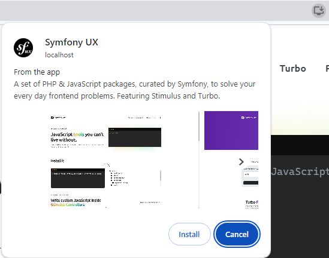

# Screenshots

Progressive Web App screenshots enable richer installation UI. As shown below, by default only the application name and short name are visible.

<figure markdown="span">
  
  <figcaption>GitHub installation UI</figcaption>
</figure>

However, by including screenshots in the web app manifest, the installation experience can be significantly improved. These screenshots give users a visual preview of the app, enhancing their understanding and increasing the likelihood of installation.

Screenshots should showcase the most important functionalities of your application and be of high quality to attract users.

In the example below, a selection of screenshots are visible and the user can navigate to show them all. On mobile devices, the interface is different, but shows the same information.

<figure markdown="span">
  
</figure>

## Generating screenshots

The recommended way to manage screenshots is using the `#[Screenshot]` PHP attribute on your controller methods. This approach automatically generates screenshots and integrates them into your manifest.

[screenshots.md](../image-management/screenshots.md)

## Manifest parameters

When screenshots are added to the manifest (either automatically via attributes or manually), the following parameters are available:

### `src` parameter

See the description [on the `icon` page](icons.md#src-parameter).

Ensure that the screenshots you provide are of high quality. Crisp and clear images can make a significant difference in how users perceive your app.

### `type` parameter

This parameter is similar to [the `format` parameter for the icons](icons.md#type-parameter).

### `label` parameter

The label parameter provides a way to give a brief description or caption for the screenshot. This helps users to understand what the feature or screen is about before they have installed the app.

### `platform` parameter

The `platform` parameter specifies which operating system the screenshot is intended for.

Possible values include:

* Device platform identifiers:
  * `"android"`
  * `"chromeos"`
  * `"ipados"`
  * `"ios"`
  * `"kaios"`
  * `"macos"`
  * `"windows"`
  * `"xbox"`
* Distribution platform identifiers:
  * `"chrome_web_store"`
  * `"itunes"`
  * `"microsoft-inbox"`
  * `"microsoft-store"`
  * `"play"`

### `form_factor` parameter

The `form_factor` parameter defines the intended device form factor for your screenshots.

Possible values:

* `"narrow"`: For narrow screen devices, like phones.
* `"wide"`: For wider screen devices, such as tablets or desktops.

!!! info

    When using the `#[Screenshot]` attribute, `form_factor` is automatically calculated based on the screenshot dimensions.
