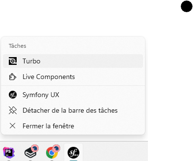

# Shortcuts

PWA shortcuts can be added to any web app manifest by including the `shortcuts` property, which is an array of objects each representing a shortcut. This can enhance user engagement and make your app more accessible.

<figure markdown="span">
  
</figure>

When designing shortcuts for your Progressive Web App, keep the following tips in mind:

* **Keep It Simple**: Shortcuts should be straightforward and provide clear value to the user.
* **Use Icons**: Visual representation makes shortcuts more recognizable and user-friendly.
* **Limit the Number**: Too many shortcuts can overwhelm users; focus on the most important actions.

Adding shortcuts is a small but effective addition to enhance your PWA's user experience.

!!! info

    Remember to periodically review your shortcuts to ensure they remain relevant and beneficial to your users. Shortcuts are a dynamic feature and should evolve as your application grows and changes.

## Configuration

```yaml title="/config/packages/pwa.yaml" linenums="1"
pwa:
    manifest:
        enabled: true
        shortcuts:
            - name: "Start New Conversation"
              short_name: "New Chat"
              description: "Create a new conversation."
              url: "/start-chat"
              icons":          
                - src: "icons/feature1-96x96.png"
                  sizes: [96]
            - name: "View Unread Messages"
              short_name: "Unread"
              description: "View unread messages."
              url: "/unread-messages"
              icons:
                - src: "icons/feature2-96x96.png"
                  sizes: [96]
```

### `name` and `short_name` parameters

The `name` parameter in each shortcut object is used to define the full name of the shortcut, which will be displayed to the user. It should be descriptive enough to communicate the action that will be taken when the shortcut is activated, but also concise enough to be quickly understood.&#x20;

#### Best practices for naming shortcuts:

* **Be Descriptive**: Choose a name that clearly explains what the shortcut does (e.g., "Add to Favorites" is better than just "Add").
* **Be Consistent**: Use a consistent naming convention across all shortcuts to prevent user confusion.
* **Avoid Jargon**: Use language that is easily understandable by all users, regardless of their technical knowledge.

Don't forget to include the `short_name` parameter if the name is too long to be displayed in full on all devices. The `short_name` is a more concise version of `name`, which can be used when there's insufficient space.

### `url` parameter

The `url` parameter specifies the URL to which the user should be navigated when they activate the shortcut. It indicates the location or feature within the application that corresponds to that specific shortcut.

The URL can be a controller route name, with or without parameters, an absolute or a relative URL.

```yaml title="/config/packages/pwa.yaml" linenums="1"
pwa:
    manifest:
        shortcuts:
            - name: "Feature #1"
              short_name: "feature-1"
              url: "app_feature1" # route name
            - name: "Feature #2"
              short_name: "feature-2"
              url:
                  path: "app_feature2" # route name
                  params: # route parameters
                      key: "value2"
            - name: "Feature #3"
              short_name: "feature-3"
              url: "/feature/3" # relative URL
            - name: "Feature #4"
              short_name: "feature-4"
              url: "https://foo.com/bar/feature-4" # absolute URL
            - name: "Feature #5"
              short_name: "feature-5"
              url:
                  path: "app_feature5" # route name
                  path_type_reference: 3 # Network URL

```

The path\_type\_reference option expects an integer where:

* `0`: absolute URL (e.g. `https://app.com/foo/bar`)
* `1`: absolute path (e.g. `/foo/bar`)
* `2`: relativepath (e.g. `../bar`)
* `3`: network path (e.g. `//app.com/foo/bar`)

!!! warning

    With absolut URLs, please make sure the Request Context is set. See [the router configuration](https://symfony.com/doc/current/routing.html#generating-urls-in-commands) for more informaiton.

### `description` parameter

The description parameter helps the user understanding the purpose of the shortcut.

### `icons` parameter

Adding icons to shortcuts not only makes them visually appealing but also helps users to quickly identify the action they represent. Icons for shortcuts can be defined within the `icons` array and it's important that these are clear and relevant to the function of the shortcut. Icons should be provided in multiple sizes to ensure that they display well on all devices.

See the definition [on the `icon` page](icons.md).

!!! warning

    The presence of a 96x96 icon is highly recommended for shortcuts.
